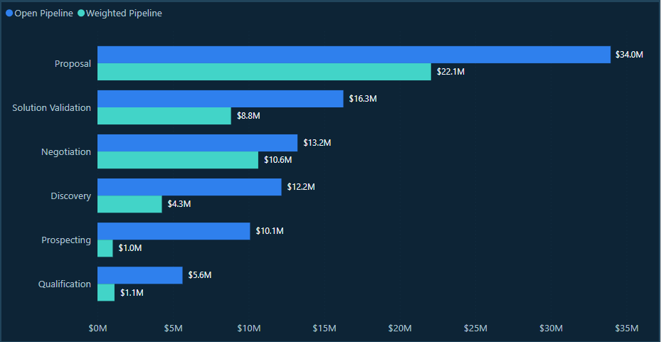
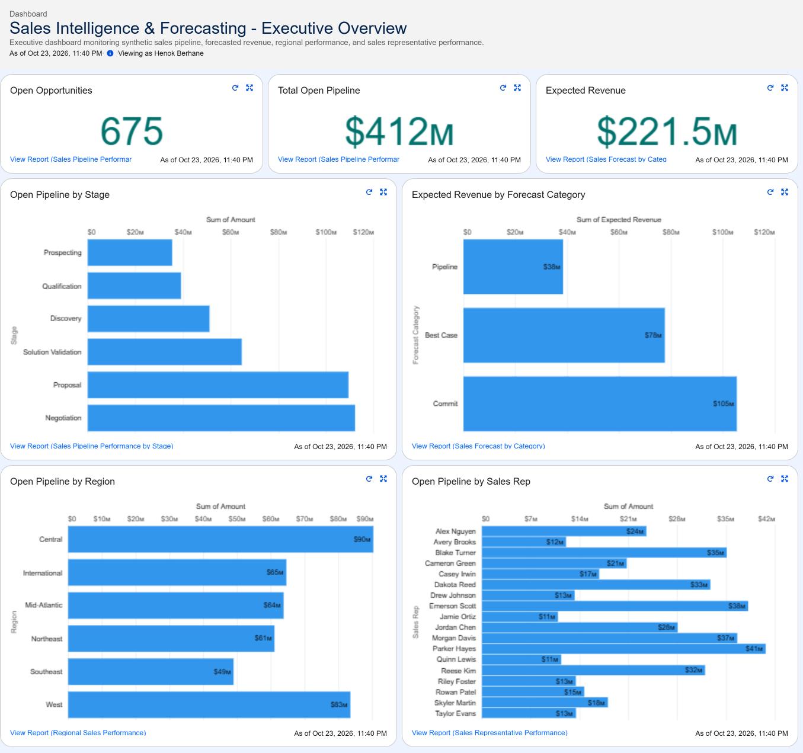

# Sales Intelligence & Forecasting

**Business Intelligence Case Study | SQL • Excel • Power BI • Salesforce**

*An independent, end-to-end analytics project using synthetic enterprise sales data.*

## Project Overview

How reliable is a sales forecast when the underlying CRM data contains duplicates, inconsistent opportunity information, and deals with questionable forecast assumptions?

I developed this case study to investigate that question.

Using a simulated enterprise sales environment, I built an analytical workflow to evaluate CRM data quality, assess pipeline and quota performance, identify forecast risks, and translate findings into actionable reporting for sales leadership.

The project builds on my professional experience in business intelligence, SQL, Power BI, Tableau, data validation, KPI reporting, and stakeholder-facing analytics. I applied analytical practices I've used in previous roles to a new business scenario while expanding into revenue forecasting, CRM analytics, and opportunity-level risk assessment.

The result is a collection of SQL analyses, an Excel analytical workbook, a five-page Power BI Command Center, a Salesforce CRM reporting simulation, and an executive business review.

**Project scope:** Independent portfolio case study using entirely synthetic business data.

## Dashboards & Project Deliverables

The project combines analytical reporting with executive-level decision support.

| Deliverable | Access |
|---|---|
| Power BI Command Center | [View Power BI Report](05_PowerBI/Sales_Intelligence_Forecast_Confidence_Command_Center.pbix) |
| Executive Business Review | [View Executive QBR](06_QBR_Executive/Sales_Intelligence_Forecasting_Executive_QBR.pptx) |
| Salesforce Executive Dashboard | [View CRM Dashboard](04_Salesforce_Simulation/Salesforce_Executive_Dashboard.png) |
| SQL Duplicate Reconciliation | [Review SQL Analysis](02_SQL/06_duplicate_impact_qa.sql) |
| Technical Methodology | [Review Methodology](07_Documentation/METHODOLOGY.md) |

### Sales Pipeline Performance

### Salesforce Executive Dashboard

## Business Challenge

Sales leadership needed greater confidence in reported pipeline values, revenue forecasts, and sales performance.

The central challenge was determining whether the underlying opportunity data could support reliable business decisions.

I structured the analysis around three questions:

1. **Data reliability:** Are duplicate, incomplete, or inconsistent records affecting reported financial results?
2. **Forecast credibility:** Does the existing pipeline provide a reasonable basis for evaluating future revenue expectations?
3. **Management priorities:** Which opportunities, representatives, or reporting issues require further investigation?

This approach allowed me to evaluate data reliability before relying on the reported business metrics.

## Key Findings

### 1. Duplicate Records Created $6.32M in Potential Reporting Inflation

Initial SQL profiling identified 10 exact duplicate opportunity records.

| Measure | Result |
|---|---:|
| Original Opportunity Records | 1,500 |
| Deduplicated Records | 1,490 |
| Exact Duplicates Removed | 10 |
| Potential Amount Overstatement | $6,321,000 |

Rather than changing the original source data, I created a deduplicated analytical view and reconciled the difference between raw and deduplicated reporting populations.

**Business implication:** A relatively small number of duplicate records can materially distort reported financial values.

The $6.321M represents potential overstatement across the full synthetic dataset, not a confirmed FY2026 Q3 revenue impact.

### 2. Open Pipeline Was Significantly Higher Than Probability-Weighted Pipeline

The validated FY2026 Q3 results showed:

| Financial KPI | Result |
|---|---:|
| Bookings | $40.13M |
| Quarterly Quota | $24.65M |
| Quota Attainment | 162.82% |
| Open Pipeline | $91.35M |
| Weighted Pipeline | $47.94M |
| Gross Pipeline Coverage | 3.71× |
| Weighted Pipeline Coverage | 1.95× |

The approximately $43.41M difference between open and weighted pipeline highlighted the importance of evaluating probability assumptions rather than relying on nominal deal values alone.

Weighted pipeline provides a probability-adjusted view of potential revenue, but it does not guarantee realized bookings or establish forecast accuracy.

**Business implication:** Leadership should examine both pipeline value and the credibility of the underlying opportunity assumptions.

### 3. Strong Quota Attainment Did Not Eliminate Forecast Risk

I analyzed multiple risk indicators to identify opportunities that might require additional management attention:

- Stage and forecast-category alignment.
- Stale opportunity activity.
- Repeated expected-close-date postponements.
- Forecast-category downgrades.

Using SQL window functions and opportunity-history data, I combined these indicators into a transparent, rules-based forecast-risk framework.

Across the broader validated open-opportunity population, the analysis identified **29 priority opportunities**, including two High Risk and 27 Medium Risk opportunities.

**Business implication:** Strong overall sales performance does not eliminate the need to investigate individual deal risks and forward-looking pipeline coverage.

The classification is intended to prioritize review, not statistically predict deal outcomes.

### 4. Data Quality and CRM Import Success Required Separate Validation

After deduplication, 1,406 of 1,490 opportunity records passed the defined analytical quality checks, a **94.4% quality pass rate**.

Separately, the Salesforce simulation successfully processed 1,406 opportunities through an external-ID-based upsert.

| Salesforce Import Result | Count |
|---|---:|
| Created | 1,401 |
| Updated | 5 |
| Data Loader Errors | 0 |

These results represent different validation measures. A successful CRM import confirms technical processing success, but it does not independently establish that every business attribute is accurate.

**Business implication:** Reliable reporting requires both technical reconciliation and business-level data-quality controls.

## Analytical Decisions & Problem-Solving

My focus throughout the project was understanding the reliability of the data, questioning assumptions, and connecting the results to business decisions.

### Preserve Source Data While Building a Trusted Reporting Layer

Instead of manually deleting problematic source records, I used SQL views to separate raw data from deduplicated, standardized, and quality-validated reporting populations.

This approach preserved traceability while providing a defined analytical foundation.

### Evaluate Forecast Confidence Using Multiple Signals

Opportunity probability and forecast category alone did not provide enough context to assess forecast credibility. I examined stage alignment, activity recency, close-date history, and forecast movement to identify deals requiring further investigation.

### Combine Performance Metrics with Forward Pipeline Coverage

Quota attainment measures performance against a target, while weighted pipeline coverage offers a separate perspective on remaining opportunity value. Evaluating these measures together supports more informed sales performance reviews than relying exclusively on bookings or rankings.

### Connect Analysis to Management Actions

The Power BI Leadership Actions page and Excel management tracker connect priority opportunities with identified risks, recommended actions, responsible owners, and follow-up dates. This extends the analysis beyond identifying problems into proposing a structured process for addressing them within the fictional business scenario.

## Technical Approach

| Technology | Application |
|---|---|
| **MySQL** | Source profiling, deduplication, data-quality controls, reconciliation, sales analysis, and opportunity-history investigation |
| **Excel** | Financial reconciliation, quota and pipeline analysis, forecast-risk review, and management tracking |
| **Power BI / DAX** | Dimensional modeling, KPI calculations, interactive reporting, risk analysis, and opportunity-level drillthrough |
| **Salesforce CRM** | Synthetic opportunity import, external-ID-based upsert, import validation, reporting, and executive dashboard |
| **PowerPoint** | Executive business review, findings, risks, and strategic recommendations |

### Power BI Reporting Architecture

The Power BI model uses opportunity, quota, and forecast-risk fact tables supported by shared dimensions.

The report contains five pages:

1. **QA Validation:** Reporting controls and KPI reconciliation.
2. **Executive Overview:** Business performance and forecast exposure.
3. **Leadership Actions:** Risk prioritization and recommended management follow-up.
4. **Pipeline & Forecast:** Pipeline composition, weighted coverage, and forecast analysis.
5. **Opportunity Detail:** Individual opportunity investigation and recommended actions.

DAX measures use appropriate date relationships for their reporting purposes. For example, Bookings uses actual close dates, while open pipeline reporting uses expected close dates.

The Salesforce reporting simulation is a complementary component, not a continuously synchronized production integration.

## Documentation & Validation

Detailed supporting documentation is available for reviewers who want to explore the analytical decisions, reconciliation procedures, and business findings.

| Document | Description |
|---|---|
| [Data Validation](07_Documentation/DATA_VALIDATION.md) | Duplicate reconciliation, financial KPI checks, quality rules, and Salesforce import validation |
| [Analytical Methodology](07_Documentation/METHODOLOGY.md) | Technical architecture, analytical decisions, modeling, and problem-solving approach |
| [Key Findings](07_Documentation/KEY_FINDINGS.md) | Business insights, forecasting concerns, and leadership recommendations |
| [Original Business Scenario](07_Documentation/PROJECT_SCENARIO.txt) | Synthetic business requirements and project context |

## Project Scope & Limitations

The original synthetic data snapshot is August 17, 2026. The principal financial analysis focuses on FY2026 Q3, while selected forecast-risk analyses and the Salesforce dashboard use broader reporting populations.

The forecast-risk framework uses defined analytical business rules rather than a statistically trained prediction model. Recommended management actions are proposed within the simulation; no realized operational improvements or financial savings are claimed.

This is an independent portfolio project developed using fictional business data. It does not represent work commissioned by or performed for an actual company, and the analytical components are not presented as a production CRM integration.

---

**Project focus:** Business intelligence, data validation, revenue analytics, forecasting, analytical problem-solving, and executive decision support.

## Power BI Data Sources & Refresh

The Power BI Command Center uses imported synthetic data from three CSV files located in `03_Excel_Analysis`:

- `Opportunity_Data.csv`
- `Quota_Data.csv`
- `Forecast_Risk_Data.csv`

The `.pbix` file contains the saved analytical model, DAX measures, and report visuals.

Because the report was developed using local Windows file paths, users opening it on another computer may need to update the CSV source paths in Power BI Desktop through **File → Options and settings → Data source settings → Change Source** before refreshing the data.

The original synthetic data snapshot is preserved in the repository to support review and reproducibility.